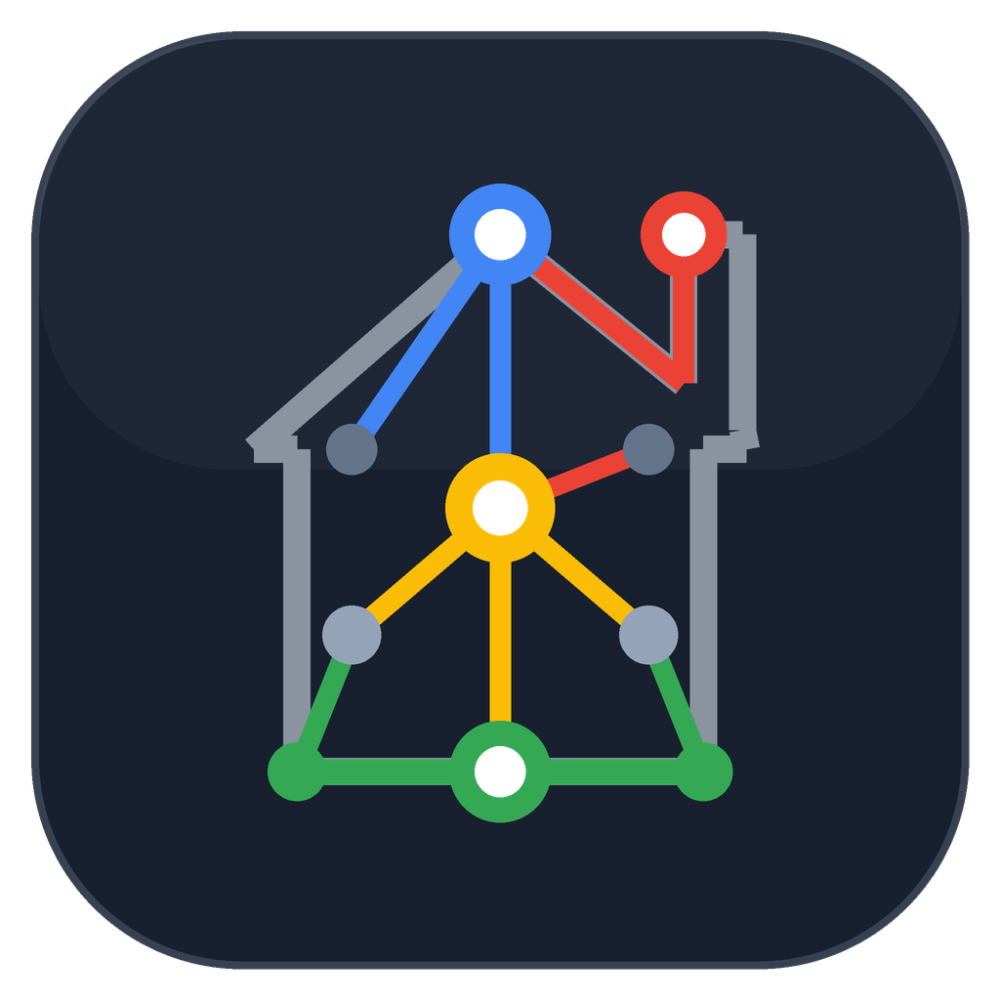

# Google Assistant Entity Console

<p align="center">
  
</p>

<p align="center">
  <b>A native Home Assistant custom component providing a sidebar dashboard to manage Google Assistant entity exposure, voice nicknames, regex blocklists, and YAML generation.</b>
</p>

<p align="center">
  <a href="#key-features">Key Features</a> •
  <a href="#installation">Installation</a> •
  <a href="#configuration">Configuration</a> •
  <a href="#ai-assistant-integration">AI Features</a> •
  <a href="#documentation">Documentation</a> •
  <a href="#faq--troubleshooting">FAQ</a>
</p>

---

## Overview

Configuring entities exposed to Google Assistant in Home Assistant traditionally requires manual YAML configuration, tracking entity IDs, maintaining aliases, and reloading configurations.

**Google Assistant Entity Console** provides a native sidebar dashboard to manage Google Assistant entity configuration visually. It queries the Home Assistant registry (floors, areas, devices, entities), renders dual-layout entity trees, generates voice nicknames using local or cloud models or native Assist conversation agents, and writes structured YAML configuration files (`gaGen_YYMMDD.yaml`) with support for zero-downtime reloads.

---

## Key Features

- **Native Sidebar Panel**: Integrates into the Home Assistant sidebar as a native panel (`google-assistant-entity-console-panel`).
- **Dual Grouping Layouts**:
  - **Location-First (Default)**: Group entities by Floor &rarr; Room (Area) &rarr; Domain &rarr; Entity Row.
  - **Domain-First (Alternate)**: Group entities by Domain &rarr; Floor &rarr; Room (Area) &rarr; Entity Row.
- **Batch Controls**: Expand or collapse nested sections across an entire floor, room, or domain with a single click.
- **Direct Row Interactions**:
  - **Exposure Status**: Toggle entity exposure state (*Exposed*, *Pending Add*, *Pending Remove*, *Not Exposed*).
  - **Inline Renaming**: Edit entity display names directly on the row.
  - **Voice Nickname Chips**: View, add, or delete voice aliases (nicknames) with chip management.
- **Regex Blocklist Manager**: Filter out entities or domain patterns (e.g. `.*_battery_level$`) using regular expression rules with live validation.
- **AI Assistant Integration**:
  - Suggest entity exposure based on natural-language requests (e.g., *"Expose all living room lights and climate controls"*).
  - Bulk and room-aware voice nickname generation using local LLMs (Ollama, LocalAI, vLLM), cloud endpoints (OpenAI, OpenRouter, Groq), or Home Assistant Assist conversation agents.
- **Theme Inheritance**: Automatically inherits the active Home Assistant dashboard theme (light, dark, Mushroom, Catppuccin, Nord, etc.) via standard CSS custom properties (`--primary-background-color`, etc.).
- **YAML Generation & Reload**: Generates `gaGen_YYMMDD.yaml` with support for Home Assistant `!secret` and `!include` tags, and triggers configuration reloads via `homeassistant.reload_config_entry`.

---

## Screenshot Previews

### Location-First Layout (`Floor -> Room -> Domain`)


### Domain-First Layout (`Domain -> Floor -> Room`)


### Regex Blocklist Manager


---

## Installation

### Method 1: HACS (Recommended)

1. Open **HACS** in your Home Assistant sidebar.
2. Click the three dots (⋮) in the top-right corner and select **Custom repositories**.
3. Enter the repository URL: `https://github.com/spelech/GoogleAssistantEntityConsole`
4. Select **Integration** as the Category and click **Add**.
5. Find **Google Assistant Entity Console** in HACS, click **Download**, and select the latest release.
6. Restart Home Assistant.

### Method 2: Manual Installation

1. Download the latest release `.zip` from the [Releases](https://github.com/spelech/GoogleAssistantEntityConsole/releases) tab.
2. Extract and copy the `custom_components/google_assistant_entity_console/` directory into your Home Assistant `/config/custom_components/` directory.
3. Restart Home Assistant.

---

## Configuration

Once installed and Home Assistant has restarted:

1. In Home Assistant, navigate to **Settings** > **Devices & Services**.
2. Click **Add Integration** in the bottom-right corner.
3. Search for **Google Assistant Entity Console** and select it.
4. Complete the configuration wizard. A new **Google Sync** panel will appear in your sidebar.

### Linking with `configuration.yaml`

To link the generated YAML configuration file to Home Assistant's built-in `google_assistant:` integration, add an include statement pointing to the generated file inside your `configuration.yaml`:

```yaml
google_assistant: !include gaGen_062226.yaml
```

The console will read, update, and rewrite this file whenever a rebuild is triggered from the sidebar panel.

---

## AI Assistant Integration

The console supports optional AI-assisted workflows using local or remote endpoints:

- **Local LLMs**: Connect to local OpenAI-compatible endpoints such as Ollama, LocalAI, vLLM, or LM Studio (`http://192.168.1.x:11434/v1`) without sending data to external services.
- **Home Assistant Conversation Agents**: Connect directly to configured Home Assistant Assist / Conversation agents using `async_converse`.
- **Context-Aware Nickname Generation**: Inspects other entities in the same area to avoid duplicate or conflicting voice commands.

For setup details and custom prompt templates, see the [AI Integration Guide](docs/AI_INTEGRATION.md).

---

## Documentation

- **[Architecture Overview](docs/ARCHITECTURE.md)**: Details on backend views, entity registry resolution, YAML serialization, regex blocklists, and frontend Web Component architecture.
- **[AI Integration Guide](docs/AI_INTEGRATION.md)**: Configuration details for OpenAI-compatible endpoints, HA Assist agents, and prompt customization.
- **[Dashboard Theme Integration](docs/THEMING.md)**: Mapping of Home Assistant CSS custom properties to Material Design 3 design tokens.

---

## FAQ & Troubleshooting

### Q: Do I need to restart Home Assistant every time I change exposed entities?
**No.** After rebuilding the YAML configuration file in the console, select **Reload Config** to trigger `homeassistant.reload_config_entry` for zero-downtime updates without a core restart.

### Q: Will this overwrite existing secrets or custom YAML tags?
**No.** The backend uses custom PyYAML `SafeDumper` and `SafeLoader` representers to preserve `!secret` and `!include` tags.

### Q: Why are some entities missing from the console?
Google Assistant supports specific Home Assistant domains (`light`, `switch`, `climate`, `lock`, `cover`, `fan`, `vacuum`, `media_player`, `alarm_control_panel`, `camera`, `scene`, `script`, etc.) and binary sensors with specific device classes (`door`, `garage_door`, `lock`, `opening`, `window`, etc.). Unsupported entities are filtered out automatically.

### Q: Is data sent to external servers when using AI features?
**No, unless configured to do so.** The AI integration defaults to local endpoints (such as Ollama on the local network) or native Home Assistant Assist agents. External requests are only sent if a cloud provider URL and API key are configured.

---

## License

Distributed under the MIT License. See `LICENSE` for more information.
