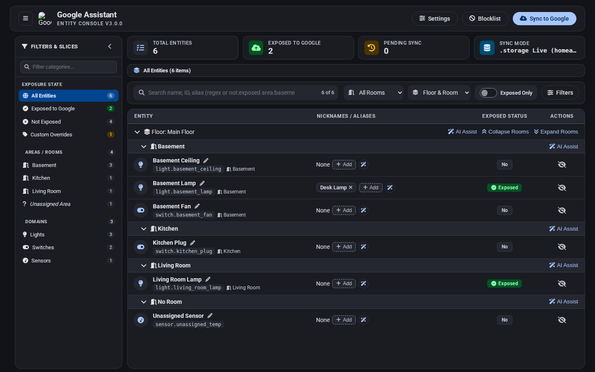
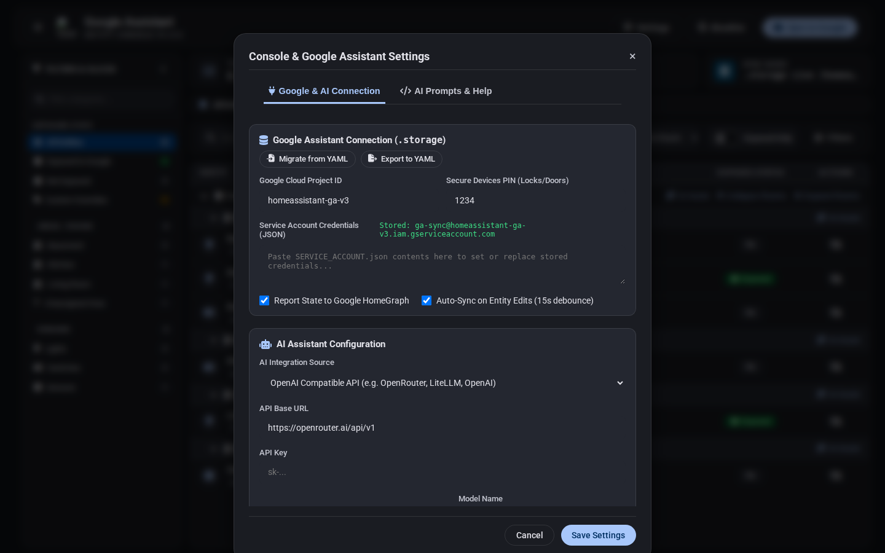

# Google Assistant Entity Console

<p align="center">
  
</p>

<p align="center">
  <b>A native Home Assistant custom component providing a sidebar dashboard to manage Google Assistant entity exposure, voice nicknames, regex blocklists, and zero-reboot <code>.storage</code> live syncing.</b>
</p>

<p align="center">
  <a href="#key-features">Key Features</a> •
  <a href="#installation">Installation</a> •
  <a href="#configuration">Configuration</a> •
  <a href="#mcp-server-model-context-protocol">MCP Server</a> •
  <a href="#ai-assistant-integration">AI Features</a> •
  <a href="#documentation">Documentation</a> •
  <a href="#faq--troubleshooting">FAQ</a>
</p>

---

## Overview

Self-hosted Google Assistant in Home Assistant traditionally requires manual YAML configuration (`configuration.yaml`), tracking entity IDs, maintaining aliases, and restarting Home Assistant whenever exposed entities change.

**Google Assistant Entity Console v3.0.0** eliminates YAML generation and Home Assistant restarts entirely. It provides a native `.storage`-backed sidebar dashboard that manages your Google Cloud credentials (`project_id`, `service_account`, `report_state`, `secure_devices_pin`), entity exposure, and voice nicknames in memory and syncs live to Google HomeGraph (`devices:requestSync`) with a single click—or automatically with a 15-second debounce.

---

## Key Features

- **100% `.storage`-Native & Zero-Reboot Live Sync (v3.0.0)**:
  - Stores Google Cloud credentials, entity sync state, regex blocklists, and AI settings in `.storage/google_assistant_entity_console`.
  - Updates Home Assistant Core's `GoogleConfig` in memory on every edit and pushes changes live to Google HomeGraph via **Sync to Google** (or optional 15s debounced auto-sync) without restarting Home Assistant.
  - **Auto-Import & One-Click YAML Migration**: Automatically imports existing `project_id`, `service_account` (`SERVICE_ACCOUNT.json`), and `secrets.yaml` values on first run and provides a one-click **Migrate from YAML** button.
- **Native Sidebar Panel**: Integrates into the Home Assistant sidebar as a native panel (`google-assistant-entity-console-panel`).
- **Slicing Sidebar & Dual Grouping Layouts**:
  - **Location-First (Default)**: Group entities by Floor &rarr; Room (Area) &rarr; Domain &rarr; Entity Row.
  - **Domain-First (Alternate)**: Group entities by Domain &rarr; Floor &rarr; Room (Area) &rarr; Entity Row.
- **Direct Row Interactions**:
  - **Exposure Status**: Toggle entity exposure state (*Exposed*, *Pending Add*, *Pending Remove*, *Not Exposed*).
  - **Inline Renaming**: Edit entity display names directly on the row.
  - **Voice Nickname Chips**: View, add, or delete voice aliases (nicknames) with chip management.
- **Regex Blocklist Manager**: Filter out entities or domain patterns (e.g. `.*_battery_level$`) using regular expression rules with live validation.
- **Native Model Context Protocol (MCP) Server**: Exposes an MCP 2026-07-28 Streamable HTTP endpoint for AI coding agents and LLM gateways (Antigravity, Claude, MCG) to query and manage entities, nicknames, blocklists, and sync live to Google HomeGraph.
- **AI Assistant Integration**:
  - Suggest entity exposure based on natural-language requests (e.g., *"Expose all living room lights and climate controls"*).
  - Bulk and room-aware voice nickname generation using local LLMs (Ollama, LocalAI, vLLM), cloud endpoints (OpenAI, OpenRouter, Groq), or Home Assistant Assist conversation agents.
- **Theme Inheritance**: Automatically inherits the active Home Assistant dashboard theme (light, dark, Mushroom, Catppuccin, Nord, etc.) via standard CSS custom properties (`--primary-background-color`, etc.).

---

## Screenshot Previews

### v3.0.0 `.storage` Live Sync Dashboard


### v3.0.0 `.storage` Google Assistant & AI Settings Modal


### Location-First Layout (`Floor -> Room -> Domain`)


### Domain-First Layout (`Domain -> Floor -> Room`)


### Regex Blocklist Manager


---

## Installation

### Method 1: HACS (Recommended)

1. Open **HACS** in your Home Assistant sidebar.
2. Click the three dots (⋮) in the top-right corner and select **Custom repositories**.
3. Enter the repository URL: `https://github.com/spelech/GoogleAssistantEntityConsole`
4. Select **Integration** as the Category and click **Add**.
5. Find **Google Assistant Entity Console** in HACS, click **Download**, and select the latest release.
6. Restart Home Assistant.

### Method 2: Manual Installation

1. Download the latest release `.zip` from the [Releases](https://github.com/spelech/GoogleAssistantEntityConsole/releases) tab.
2. Extract and copy the `custom_components/google_assistant_entity_console/` directory into your Home Assistant `/config/custom_components/` directory.
3. Restart Home Assistant.

---

## Configuration

Once installed and Home Assistant has restarted:

1. In Home Assistant, navigate to **Settings** > **Devices & Services**.
2. Click **Add Integration** in the bottom-right corner.
3. Search for **Google Assistant Entity Console** and select it.
4. Open the **Google Sync** panel in your sidebar and click **Settings** to verify or configure your Google Cloud `project_id` and `SERVICE_ACCOUNT.json` credentials directly in `.storage` (or click **Migrate from YAML** to import and comment out any legacy `google_assistant:` block in `configuration.yaml`).

---

## MCP Server (Model Context Protocol)

Google Assistant Entity Console includes a native **Model Context Protocol (MCP)** server adhering to the MCP specification revision **`2026-07-28` (Streamable HTTP Transport)**.

This allows external AI coding assistants (such as Google Antigravity, Claude Desktop, Cursor) and orchestrators such as Model Context Gateway (MCG) to inspect, manage, and synchronize your Google Assistant entities programmatically without custom wrappers.

### Endpoint & Authentication

- **Endpoint**: `POST /api/google_assistant_entity_console/mcp`
- **Transport**: Streamable HTTP (`stateless`, JSON-RPC 2.0; supports standard JSON responses and `Accept: text/event-stream` SSE streaming)
- **Protocol Version**: `2026-07-28` (returned in the `Mcp-Protocol-Version` HTTP header)
- **Authentication**: Standard Home Assistant Long-Lived Access Token via HTTP header:
  ```http
  Authorization: Bearer <HA_LONG_LIVED_ACCESS_TOKEN>
  ```

### Available Tools (7 Native Tools)

| Tool | Description | Key Parameters |
| :--- | :--- | :--- |
| `list_entities` | Queries entities registered in Home Assistant along with their Google Assistant exposure status, area, floor, and aliases. | `domain`, `area`, `floor`, `exposure_status` (`all`, `exposed`, `not_exposed`, `blocked`), `search` |
| `get_entity` | Retrieves detailed Google Assistant configuration, names, aliases, and registry metadata for a single entity. | `entity_id` (required) |
| `get_google_assistant_status` | Checks cloud project status, credentials state, auto-sync setting, and exposure/synced counts. | *None* |
| `set_entity_exposure` | Exposes or unexposes one or more entities to Google Assistant in `.storage` and live memory. | `entity_ids` (required, array), `exposed` (required, boolean) |
| `set_entity_nicknames` | Modifies voice aliases used by Google Assistant for voice matching. | `entity_id` (required), `nicknames` (required, array), `mode` (`replace`, `append`, `remove`) |
| `manage_blocklist_rule` | Adds or removes regular expression blocklist filters. | `action` (`add`, `remove`), `pattern` (e.g. `.*_battery_level$`) |
| `sync_to_google` | Triggers a real-time zero-reboot `devices:requestSync` call to Google HomeGraph. | *None* |

### Client Configuration Examples

#### 1. Model Context Gateway (MCG) / Antigravity (`agy`) / HTTP Clients
In your MCP configuration file (e.g. `mcg.config.json` or Antigravity MCP settings):

```json
{
  "mcpServers": {
    "google-assistant-entity-console": {
      "url": "http://<YOUR_HA_HOST>:8123/api/google_assistant_entity_console/mcp",
      "transport": "http",
      "headers": {
        "Authorization": "Bearer <YOUR_HA_LONG_LIVED_ACCESS_TOKEN>"
      }
    }
  }
}
```

#### 2. Claude Desktop / Local CLI Bridge (via `mcp-remote`)
If using an MCP proxy runner such as `mcp-remote`:

```json
{
  "mcpServers": {
    "google-assistant-entity-console": {
      "command": "npx",
      "args": [
        "-y",
        "mcp-remote",
        "http://<YOUR_HA_HOST>:8123/api/google_assistant_entity_console/mcp",
        "--header",
        "Authorization: Bearer <YOUR_HA_LONG_LIVED_ACCESS_TOKEN>"
      ]
    }
  }
}
```

#### 3. Direct JSON-RPC 2.0 Request (cURL)
```bash
curl -X POST "http://<YOUR_HA_HOST>:8123/api/google_assistant_entity_console/mcp" \
  -H "Authorization: Bearer <YOUR_HA_LONG_LIVED_ACCESS_TOKEN>" \
  -H "Content-Type: application/json" \
  -d '{
    "jsonrpc": "2.0",
    "method": "tools/call",
    "params": {
      "name": "list_entities",
      "arguments": {
        "domain": "light",
        "exposure_status": "exposed"
      }
    },
    "id": 1
  }'
```

---

## AI Assistant Integration

The console supports optional AI-assisted workflows using local or remote endpoints:

- **Local LLMs**: Connect to local OpenAI-compatible endpoints such as Ollama, LocalAI, vLLM, or LM Studio (`http://192.168.1.x:11434/v1`) without sending data to external services.
- **Home Assistant Conversation Agents**: Connect directly to configured Home Assistant Assist / Conversation agents using `async_converse`.
- **Context-Aware Nickname Generation**: Inspects other entities in the same area to avoid duplicate or conflicting voice commands.

For setup details and custom prompt templates, see the [AI Integration Guide](docs/AI_INTEGRATION.md).

---

## Documentation

- **[Architecture Overview](docs/ARCHITECTURE.md)**: Details on backend views, entity registry resolution, `.storage` persistence, regex blocklists, and frontend Web Component architecture.
- **[AI Integration Guide](docs/AI_INTEGRATION.md)**: Configuration details for OpenAI-compatible endpoints, HA Assist agents, and prompt customization.
- **[Dashboard Theme Integration](docs/THEMING.md)**: Mapping of Home Assistant CSS custom properties to Material Design 3 design tokens.

---

## FAQ & Troubleshooting

### Q: Do I need to restart Home Assistant or maintain YAML files when I change exposed entities?
**No.** Starting in v3.0.0, all entity exposure changes, nicknames, and rooms are updated in Home Assistant's live `GoogleConfig` memory immediately and synced directly to Google HomeGraph via **Sync to Google** (or automatic 15-second debounced sync) with zero restarts and zero YAML files.

### Q: Why are some entities missing from the console?
Google Assistant supports specific Home Assistant domains (`light`, `switch`, `climate`, `lock`, `cover`, `fan`, `vacuum`, `media_player`, `alarm_control_panel`, `camera`, `scene`, `script`, etc.) and binary sensors with specific device classes (`door`, `garage_door`, `lock`, `opening`, `window`, etc.). Unsupported entities are filtered out automatically.

### Q: Is data sent to external servers when using AI features?
**No, unless configured to do so.** The AI integration defaults to local endpoints (such as Ollama on the local network) or native Home Assistant Assist agents. External requests are only sent if a cloud provider URL and API key are configured.

---

## License

Distributed under the MIT License. See `LICENSE` for more information.
