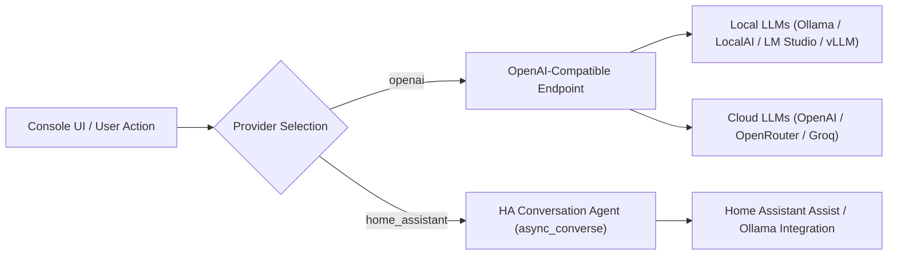

# AI Assistant Integration Guide

Google Assistant Entity Console includes optional AI features to generate voice nicknames and suggest entity exposure using either local LLMs or cloud providers.

---

## 1. Overview & Capabilities

Configuring voice control for Google Assistant requires determining which entities to expose and assigning voice aliases (nicknames). The integration provides three AI endpoints:

### 1.1 Intent-Driven Exposure Suggestions (`AISuggestExposureView`)
Evaluates natural-language requests (such as *"Expose all living room lights, kitchen climate controls, and front door locks"*) against the active entity inventory. The endpoint returns a JSON array of matching entity IDs to update the pending exposure selection in the UI.

### 1.2 Bulk Nickname Generation (`AIGenerateNicknamesView`)
Generates 2–4 voice aliases for a batch of entities based on entity IDs and friendly names. For example, for `light.kitchen_pendant_light_1`:
- "Kitchen Pendant"
- "Island Light"
- "Overhead Light"

### 1.3 Room-Aware Single Entity Generation (`AIGenerateSingleEntityNicknameView`)
Generates voice aliases for a specific device while including all other entities in the same area in the prompt context. This avoids duplicate or conflicting aliases within the same room.

---

## 2. Provider Architecture

The AI module supports two provider backends:



### 2.1 Provider 1: OpenAI-Compatible APIs
Works with any API implementing standard `/v1/chat/completions` and `/v1/models` endpoints:
- **Local Self-Hosted**: [Ollama](https://ollama.com/), [LocalAI](https://localai.io/), [LM Studio](https://lmstudio.ai/), [vLLM](https://github.com/vllm-project/vllm).
- **Cloud Providers**: OpenAI, OpenRouter, Groq, DeepSeek.

#### Configuration Options:
- **Base URL**: e.g., `http://192.168.1.100:11434/v1` (Ollama) or `https://openrouter.ai/api/v1`
- **API Key**: Optional for local endpoints; required for cloud endpoints.
- **Model Selector**: Automatically queries `/v1/models` (including OpenRouter pricing metadata where available).

### 2.2 Provider 2: Home Assistant Native Conversation Agents
Directly integrates with Home Assistant's internal `conversation` component via [`async_converse`](file:///drives/nfs/repos/google-assistant-entity-console/custom_components/google_assistant_entity_console/views.py#L589).
- Enables use of configured Assist conversation agents (such as Home Assistant's Ollama integration or Extended OpenAI Conversation) without requiring separate API tokens inside this component.
- Selectable directly via a dropdown populated by `GET /api/google_assistant_entity_console/ai/ha_agents`.

---

## 3. Prompt Templates & Customization

Prompt templates are customizable and stored in JSON format at `google_assistant_entity_console_ai_settings.json`.

### 3.1 Bulk Nickname Prompt Template
```
You are an assistant helping configure Google Assistant aliases for smart home entities.
For the following entity, generate 2-4 clean, natural-language nicknames (aliases) that a user would typically say to control the device.
Do NOT include markdown, explanations, bullet points, numbers, quotes, or punctuation.
Return the nicknames ONLY as a single comma-separated list on a single line.

Entity ID: {entity_id}
Friendly Name: {friendly_name}
Aliases:
```

### 3.2 Room-Aware Single Entity Prompt Template
```
You are an assistant helping configure Google Assistant aliases for a specific smart home entity.
For the target entity, generate 2-4 clean, natural-language nicknames (aliases) that a user would typically say to control the device.
Avoid markdown, explanations, bullet points, numbers, quotes, or punctuation.
Use the context of other entities in the same room to avoid duplicate, confusing, or conflicting names.
Return the nicknames ONLY as a single comma-separated list on a single line.

Target Entity ID: {entity_id}
Target Friendly Name: {friendly_name}
Other Entities in same room: {room_context}
Aliases:
```

### 3.3 Exposure Intent Prompt Template
```
You are an assistant helping configure which smart home entities to expose to Google Assistant.
Given a list of entities with their IDs, names, and domains, and the user's intent: '{user_intent}'.
Determine which entities from the list should be exposed.
Return ONLY a JSON list of entity IDs that should be exposed. Do not wrap in markdown codeblocks.

Entities:
{entities_list}
```

---

## 4. Privacy & Local Deployment

For local installations:
1. **Local Endpoints**: Setting the Base URL to a local server (e.g. `http://localhost:11434/v1` for Ollama) ensures requests do not leave the local network.
2. **Model Sizing**: Entity exposure selection and nickname generation are lightweight text tasks suitable for small open-weights models (3B–8B parameters).
3. **No External Dependencies**: AI functionality is optional; the console operates fully without configuring an AI provider.

