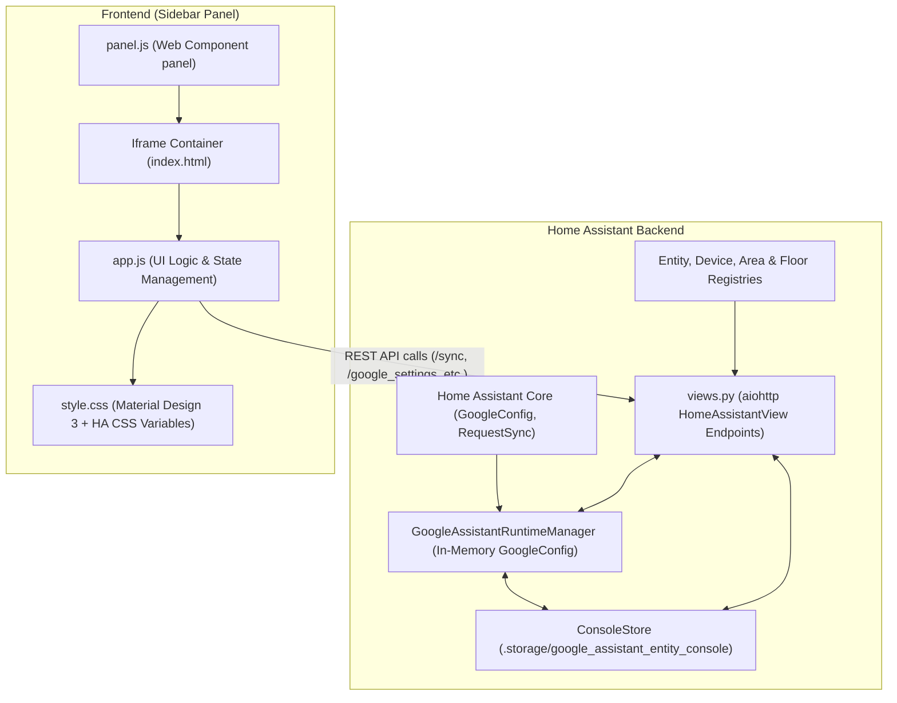

# Google Assistant Entity Console Architecture (v3.0.0)

This document provides a technical overview of the **Google Assistant Entity Console** Home Assistant custom component architecture.

---

## 1. System Overview

Google Assistant Entity Console is a Home Assistant custom component that provides a sidebar management dashboard to configure entities exposed to Google Assistant, manage voice aliases, and maintain regex blocklists with **zero-reboot `.storage`-native live syncing**.

It operates inside the Home Assistant process, combining an `aiohttp` HTTP API backend with a single-page web application served inside an iframe panel.



---

## 2. Component Lifecycle (`__init__.py`)

The integration entrypoint is defined in [`custom_components/google_assistant_entity_console/__init__.py`](file:///home/steve/Repos/GoogleAssistantEntityConsole/custom_components/google_assistant_entity_console/__init__.py).

### Setup Sequence:
1. **Async Setup Entry** (`async_setup_entry`):
   - Reads integration manifest version (`3.0.0`).
   - Initializes `ConsoleStore` via `async_get_store(hass)` to load or migrate credentials, blocklists, and sync state from `.storage/google_assistant_entity_console`.
   - Initializes `GoogleAssistantRuntimeManager` via `async_get_runtime(hass)` and hooks in-memory `GoogleConfig._config["entity_config"]`.
   - Registers static HTTP paths (`/google_assistant_entity_console/static`) pointing to the component's `static/` directory.
   - Registers all 15 backend API HTTP views on `hass.http`.
   - Registers the custom sidebar panel (`async_register_panel`) pointing to `panel.js`.
2. **Unload Entry** (`async_unload_entry`):
   - Removes the sidebar panel (`async_remove_panel`).

---

## 3. Backend Architecture

### 3.1 Persistence Engine (`store.py`)
Starting in v3.0.0, persistence is managed entirely by [`ConsoleStore`](file:///home/steve/Repos/GoogleAssistantEntityConsole/custom_components/google_assistant_entity_console/store.py) using Home Assistant's `homeassistant.helpers.storage.Store` (`.storage/google_assistant_entity_console`):
- **Credentials & Settings**: `project_id`, `service_account` (`client_email`, `private_key`), `report_state`, `secure_devices_pin`, `auto_sync`.
- **Exposed Entity Snapshot**: `synced_entities` mapping storing last-synced friendly names, aliases, and rooms.
- **Regex Blocklist**: User-defined regex patterns filter out entities or domain patterns.
- **AI Configuration**: OpenAI-compatible / HA Assist agent settings and prompt overrides.
- **Auto-Import & Migration**: On first boot, automatically imports existing credentials and settings from `configuration.yaml`, `secrets.yaml`, `gaGen_*.yaml`, and `SERVICE_ACCOUNT.json`. `async_migrate_and_disable_yaml()` comments out `google_assistant:` blocks in `configuration.yaml` in a single click.

### 3.2 Zero-Reboot Runtime Engine (`runtime.py`)
[`GoogleAssistantRuntimeManager`](file:///home/steve/Repos/GoogleAssistantEntityConsole/custom_components/google_assistant_entity_console/runtime.py) manages live interaction with Google HomeGraph without restarts:
- **Dual Mode Operation**:
  - `yaml_attached`: Attaches to an active `google_assistant` config entry and mutates `google_config._config` in place.
  - `storage`: Bootstraps `GoogleConfig` and registers `GoogleAssistantView` (`/api/google_assistant`) directly from `.storage` when no YAML integration exists.
- **Live In-Memory Mutation**: When entity exposure, aliases, or names change, `runtime.async_refresh_memory_config()` updates HA Core's `_config["entity_config"]` in memory immediately.
- **Zero-Reboot Sync**: `runtime.async_sync_to_google()` calls `google_config.async_sync_entities_all()`, issuing Google Cloud's `devices:requestSync` API to update Google HomeGraph live.
- **Debounced Auto-Sync**: An optional 15-second debounce automatically syncs entity updates in the background.

---

## 4. Frontend Architecture

The frontend is a Single-Page Application (SPA) contained within [`custom_components/google_assistant_entity_console/static/`](file:///home/steve/Repos/GoogleAssistantEntityConsole/custom_components/google_assistant_entity_console/static/).

```
static/
├── index.html   # Main HTML layout & modal templates
├── app.js       # Core UI state management, rendering, & API bindings
├── style.css    # MD3 design system & Home Assistant CSS theme mapping
└── panel.js     # Custom Web Component wrapper hosting index.html in an iframe
```

### 4.1 Header Controls
- **Sync to Google Button**: Replaces legacy YAML rebuild and restart modals. Pushes in-memory entity definitions directly to Google HomeGraph live.
- **Settings Modal**: Provides dual-tab configuration for Google Assistant `.storage` credentials (`project_id`, `SERVICE_ACCOUNT.json`, PIN, toggles, YAML migration) and AI Assistant integrations.
- **Slicing Sidebar**: Stackable category slices (Exposure State, Areas, Domains) with breadcrumb filter chips.

---

## 5. API Endpoints Reference

| Endpoint | Method | Description |
| :--- | :--- | :--- |
| `/api/google_assistant_entity_console/entities` | `GET` | Fetches entity list with area/floor context, exposure status, and sync state |
| `/api/google_assistant_entity_console/entities/update` | `POST` | Updates entity exposure status, display name, or nicknames and refreshes in-memory runtime |
| `/api/google_assistant_entity_console/sync` | `POST` | Triggers live Google HomeGraph Request Sync (`devices:requestSync`) without restart |
| `/api/google_assistant_entity_console/google_settings` | `GET`, `POST` | Reads (with redacted secrets) or updates Google Cloud credentials in `.storage` |
| `/api/google_assistant_entity_console/migrate_yaml` | `POST` | Migrates credentials to `.storage` and comments out `google_assistant:` in `configuration.yaml` |
| `/api/google_assistant_entity_console/rebuild` | `POST` | Legacy alias for `/sync` for backwards compatibility |
| `/api/google_assistant_entity_console/restart` | `POST` | Restarts Home Assistant Core (optional fallback) |
| `/api/google_assistant_entity_console/blocklist` | `GET`, `POST` | Retrieves or replaces the regex blocklist |
| `/api/google_assistant_entity_console/blocklist/add` | `POST` | Appends a single pattern to the blocklist |
| `/api/google_assistant_entity_console/ai/settings` | `GET`, `POST` | Manages AI provider configuration & prompt templates |
| `/api/google_assistant_entity_console/ai/models` | `POST` | Fetches available models & pricing from OpenAI-compatible endpoint |
| `/api/google_assistant_entity_console/ai/ha_agents` | `GET` | Lists Home Assistant Assist / Conversation agents |
| `/api/google_assistant_entity_console/ai/generate_nicknames` | `POST` | Bulk nickname generation for entity array |
| `/api/google_assistant_entity_console/ai/generate_single_nickname` | `POST` | Context-aware single entity nickname generation |
| `/api/google_assistant_entity_console/ai/suggest_exposure` | `POST` | Intent-driven entity selection |
