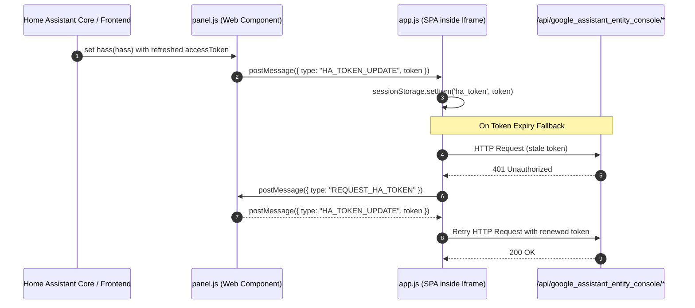

# Google Assistant Entity Console: Enhancements, Async I/O, Token Refresh, and Branding Design

**Date:** 2026-10-12  
**Status:** Approved  
**Author:** spelech / Antigravity  

---

## 1. Executive Summary

This specification outlines key architectural, user experience, developer tooling, and branding enhancements for the **Google Assistant Entity Console** Home Assistant custom component:

1. **Non-Blocking Async File I/O:** Eliminate event loop blocking (`ASYNC230`) across all backend endpoints by delegating synchronous file reads and writes to executor threads via `hass.async_add_executor_job`.
2. **Dynamic Auth Token Refresh:** Establish bidirectional messaging between the parent Home Assistant web component (`panel.js`) and the console Single-Page Application iframe (`app.js`) to automatically synchronize renewed access tokens and prevent 401 session expirations.
3. **YAML Include Directive Detection & Guidance:** Detect whether `configuration.yaml` includes the active `gaGen_*.yaml` configuration and present an actionable UI banner with a one-click copyable snippet if absent.
4. **Developer Tooling & Linting Standards:** Introduce a standardized `pyproject.toml` file enabling zero-argument `pytest` execution (`pythonpath = ["."]`) and clean up all 46 `ruff` warnings.
5. **Brand Logo Redesign:** Modernize the app and brand logo by adopting the iconic Home Assistant house network graph geometry infused with Google Assistant's signature four-color palette (`#4285F4`, `#EA4335`, `#FBBC05`, `#34A853`).

---

## 2. Architecture & Backend Enhancements (`views.py`)

### 2.1 Async File I/O Optimization
Currently, `load_blocklist`, `save_blocklist`, `load_ai_settings`, `save_ai_settings`, and `RebuildView.post` perform synchronous `with open(...)` operations on the main event loop thread.

#### Changes:
- Define discrete synchronous helper functions:
  - `_sync_read_json(filepath: str, default: Any) -> Any`
  - `_sync_write_json(filepath: str, data: Any) -> None`
  - `_sync_write_text(filepath: str, content: str) -> None`
  - `_sync_update_config_yaml(config_path: str, filename: str) -> tuple[bool, str]`
- Convert `load_blocklist`, `save_blocklist`, `load_ai_settings`, and `save_ai_settings` into async functions or wrap their I/O invocations with `await hass.async_add_executor_job(...)`.
- In `RebuildView.post`, perform the file write of `gaGen_YYMMDD.yaml` and the check/update of `configuration.yaml` in executor jobs.
- Keep the exact file paths (`/config/google_assistant_entity_console_blocklist.json`, `/config/google_assistant_entity_console_ai_settings.json`, and `/config/configuration.yaml`) intact to ensure complete backward compatibility.

### 2.2 Missing Include Directive Detection
In `RebuildView.post`:
- Read `configuration.yaml` via executor.
- Look for `include_pattern = r"google_assistant:\s*!include\s*gaGen_\d{6}\.yaml"`.
- If found:
  - Replace with `f"google_assistant: !include {filename}"`.
  - Write updated content.
  - Return `{"success": True, "has_include_directive": True, "exposed_count": exposed_count, "yaml_written": filepath}`.
- If NOT found:
  - Return `{"success": True, "has_include_directive": False, "required_include": f"google_assistant: !include {filename}", "exposed_count": exposed_count, "yaml_written": filepath}`.

### 2.3 Linter Fixes in `views.py`
- Eliminate unused local variables in `views.py`:
  - Lines 853-855: Remove unused `base_url`, `api_key`, `model` in `AISuggestExposureView`.
  - Lines 917-919: Remove unused `base_url`, `api_key`, `model` in `AIGenerateSingleEntityNicknameView`.
- Catch specific exceptions where feasible or document broad error bounds.

---

## 3. Frontend & Authentication Enhancements (`panel.js` & `app.js`)

### 3.1 Token Refresh Architecture
Home Assistant frontend rotates authentication tokens periodically. The panel wrapper (`panel.js`) receives updated `hass` properties, but the nested iframe (`index.html`) relies on the initial query parameter.



#### Implementation in `panel.js`:
- Store `this._hass = hass;`
- On `set hass(hass)`:
  - If `this._iframe && this._iframe.contentWindow && hass.auth?.accessToken`:
    - Dispatch `this._iframe.contentWindow.postMessage({ type: 'HA_TOKEN_UPDATE', token: hass.auth.accessToken }, '*')`.
- Add window event listener for messages from the child iframe:
  - When `{ type: 'REQUEST_HA_TOKEN' }` is received, respond with `{ type: 'HA_TOKEN_UPDATE', token: this._hass?.auth?.accessToken }`.

#### Implementation in `app.js`:
- Add message listener:
  ```javascript
  window.addEventListener('message', (event) => {
      if (event.data && event.data.type === 'HA_TOKEN_UPDATE' && event.data.token) {
          sessionStorage.setItem('ha_token', event.data.token);
      }
  });
  ```
- Wrap `fetch` calls with an authenticated client helper that intercepts 401 errors, requests a token renewal, and retries once before surfacing an error to the user.

### 3.2 Missing YAML Include Notice in UI
- In `handleRebuild()` in `app.js`:
  - Inspect `result.has_include_directive`.
  - If `false`, display a dedicated modal or highlight in the restart dialog with the snippet:
    ```yaml
    google_assistant: !include <filename>
    ```
  - Provide a "Copy to Clipboard" button and clear guidance that Home Assistant requires this directive in `configuration.yaml`.

---

## 4. Developer Experience & Testing (`pyproject.toml` & Test Suite)

### 4.1 `pyproject.toml` Configuration
Create `pyproject.toml` in repository root:
```toml
[tool.pytest.ini_options]
pythonpath = ["."]
testpaths = ["tests"]
asyncio_mode = "strict"

[tool.ruff]
line-length = 100
target-version = "py312"

[tool.ruff.lint]
select = ["E", "F", "W", "I", "ASYNC", "B", "SIM"]
ignore = ["ASYNC230"] # for test files reading static test fixtures if necessary
```

### 4.2 Test Suite Cleanups
- In `tests/conftest.py`: Convert mutable class attribute `extra_urls = []` to initialized instance property or `ClassVar`.
- Clean import ordering across `tests/test_blocklist.py` and `tests/test_views.py`.
- Consolidate nested `with` blocks into single compound `with` statements.
- Ensure all 336 existing tests pass cleanly without `PYTHONPATH=.`.

---

## 5. Brand & App Logo Redesign

### 5.1 Design Specifications
- **Base Geometry:** Home Assistant's iconic interconnected house network graph.
  - Roof, walls, and chimney framework formed by nodes and clean geometric edges.
- **Color Palette (Google Assistant signature colors):**
  - **Google Blue:** `#4285F4` (Roof peak and primary apex node)
  - **Google Red:** `#EA4335` (Accent node / branch)
  - **Google Yellow:** `#FBBC05` (Central living node / bridge)
  - **Google Green:** `#34A853` (Foundation / ground node)
  - **Neutral Framework:** `#5F6368` or clean semi-transparent connecting paths with rounded caps.
- **Style:** Flat, modern, vector-based, high contrast on both dark and light surfaces.

### 5.2 Asset Outputs
- `brand/logo.svg`: Master vector source.
- `brand/logo.png`: 1024x1024 master transparent PNG.
- `brand/icon.png`: 1024x1024 master icon PNG.
- `custom_components/google_assistant_entity_console/static/logo.png`: Optimized web asset for dashboard header.
- Synchronized to `/ha/823SCD-Docker/custom_components/google_assistant_entity_console/static/logo.png`.

---

## 6. Verification & Validation Plan
1. **Unit Tests:** Execute `pytest` directly to ensure 336/336 tests pass.
2. **Linting:** Execute `ruff check .` to confirm 0 errors.
3. **Async Verification:** Inspect views to ensure zero blocking `open()` calls in async contexts.
4. **Token Refresh Verification:** Simulate token update postMessage events and verify `sessionStorage` updates.
5. **Asset Inspection:** Verify rendered logo dimensions and transparency.
