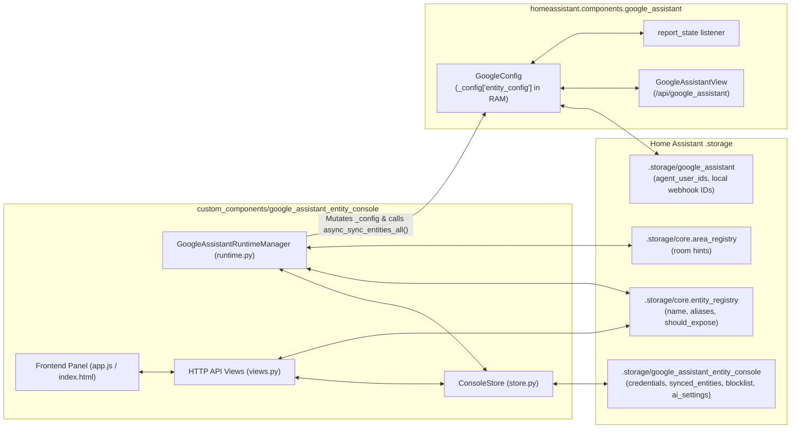

# `.storage`-Native & Zero-Reboot Google Assistant Architecture — Design Spec

**Date:** 2026-10-17  
**Author:** Steve & Antigravity  
**Status:** Approved for Planning

---

## 1. Problem Statement & Goals

Home Assistant's built-in self-hosted `google_assistant` integration requires YAML configuration (`configuration.yaml` / `!include gaGen_MMDDYY.yaml`) and a full Home Assistant Core restart whenever entity exposure, names, aliases, or credentials change. By contrast, Home Assistant Cloud (Nabu Casa) manages voice assistant entities in `.storage` and syncs changes live to Google HomeGraph without restarting.

### Primary Goals
1. **100% `.storage` Persistence (Zero `configuration.yaml` Required):**
   - Store Google Assistant project credentials (`project_id`, `service_account` JSON, `report_state`, `secure_devices_pin`, `auto_sync`), last-synced entity state (`synced_entities`), regex blocklist (`blocklist`), and AI configuration (`ai_settings`) in Home Assistant's native `.storage/google_assistant_entity_console` via `homeassistant.helpers.storage.Store`.
   - Store per-entity exposure (`options["conversation"]["should_expose"]`), display names, and aliases in Home Assistant's native `.storage/core.entity_registry`.
2. **Zero-Reboot Live Runtime & HomeGraph Sync:**
   - Manage Home Assistant Core's `GoogleConfig` (`homeassistant.components.google_assistant.http.GoogleConfig`) directly in memory.
   - Update `google_config._config["entity_config"]` immediately on every entity update in the Console.
   - Replace the two-step **Rebuild YAML + Restart HA** workflow with a single **Sync to Google** action (plus optional 15-second debounced auto-sync) that calls `await google_config.async_sync_entities_all()` (`https://homegraph.googleapis.com/v1/devices:requestSync`) live without restarting Home Assistant.
3. **Seamless Auto-Import & One-Click YAML Migration:**
   - Automatically import existing `project_id`, `service_account` (`SERVICE_ACCOUNT.json`), `secure_devices_pin`, `report_state`, `blocklist`, and `ai_settings` from legacy YAML/JSON files on first load.
   - Provide a **Google Assistant Connection** section in the Console Settings modal to view/edit credentials and a one-click **Migrate from YAML** button that comments out `google_assistant:` in `configuration.yaml` and removes any legacy `SOURCE_IMPORT` config entry.

---

## 2. System Architecture



---

## 3. Component Design

### 3.1 Native Storage Layer (`custom_components/google_assistant_entity_console/store.py`)

`ConsoleStore` wraps `homeassistant.helpers.storage.Store(hass, STORAGE_VERSION=1, STORAGE_KEY="google_assistant_entity_console")`.

#### Schema
```python
{
    "google_settings": {
        "project_id": "",
        "service_account": {},  # {"client_email": "...", "private_key": "...", ...}
        "report_state": True,
        "secure_devices_pin": "",
        "auto_sync": False,
    },
    "synced_entities": {
        # entity_id -> {"name": str, "aliases": list[str], "room": str | None}
    },
    "blocklist": [
        # list of regex strings
    ],
    "ai_settings": {
        # ai_source, ha_agent_id, base_url, api_key, model
    },
}
```

#### Automatic First-Run Migration
When `await store.async_load()` runs and finds no existing `.storage/google_assistant_entity_console` file (or empty sections):
1. **Blocklist Migration:** Reads `/config/google_assistant_entity_console_blocklist.json` if present and imports patterns into `data["blocklist"]`.
2. **AI Settings Migration:** Reads `/config/google_assistant_entity_console_ai_settings.json` if present and imports settings into `data["ai_settings"]`.
3. **YAML & Secrets Migration (`async_import_from_yaml`):**
   - Inspects `/config/configuration.yaml` for either inline `google_assistant:` or `google_assistant: !include <filename>.yaml`.
   - Loads `/config/secrets.yaml` to resolve `!secret <key>` tags (e.g., `googleassistant_projectName`, `google_device_pin`).
   - Loads any referenced `!include <service_account.json>` file (e.g., `/config/SERVICE_ACCOUNT.json`) to resolve the service account dictionary (`client_email`, `private_key`, etc.).
   - Imports `project_id`, `service_account`, `report_state`, `secure_devices_pin` into `data["google_settings"]`.
   - Imports any `entity_config` entries where `expose: true` into `data["synced_entities"]` so existing synced state is preserved immediately without requiring a full re-sync.

---

### 3.2 Zero-Reboot Runtime Manager (`custom_components/google_assistant_entity_console/runtime.py`)

`GoogleAssistantRuntimeManager` bridges `ConsoleStore` + `core.entity_registry` with Home Assistant Core's `GoogleConfig`.

#### Building `entity_config` in Memory
`await runtime.async_build_entity_config()` queries `async_fetch_entities_data(hass)` and constructs the dictionary expected by `GoogleConfig`:
```python
{
    entity["entity_id"]: {
        "expose": True,
        "name": entity["display_name"],
        "aliases": entity["aliases"],
        **({"room": entity["area"]} if entity["area"] and entity["area"] != "TBA" else {}),
    }
    for entity in active_entities
    if entity["should_expose"]
}
```

#### Dual-Mode Bootstrap (`async_initialize`)
1. **Check for Active YAML-Loaded `google_assistant` Entry (`yaml_attached` mode):**
   - Checks `hass.config_entries.async_entries("google_assistant")` for an entry with `entry.state == ConfigEntryState.LOADED` and `getattr(entry, "runtime_data", None) is not None`.
   - If found:
     - Attaches `self.google_config = entry.runtime_data`.
     - Updates `self.google_config._config["entity_config"]` in place with the `.storage`-built `entity_config`.
     - Sets `self.mode = "yaml_attached"`.
2. **Standalone `.storage` Bootstrap (`storage` mode):**
   - If `google_assistant:` is not active via YAML:
     - Removes any stale `SOURCE_IMPORT` `google_assistant` config entry whose setup failed or is unloaded so Home Assistant never logs a `KeyError: 'google_assistant_config'` on startup.
     - If `project_id` is configured in `store.google_settings`:
       - Builds the full runtime config dictionary:
         ```python
         config = {
             "project_id": google_settings["project_id"],
             "expose_by_default": False,
             "exposed_domains": list(DEFAULT_EXPOSED_DOMAINS),
             "entity_config": entity_config,
             "report_state": bool(google_settings.get("report_state", True)),
         }
         if google_settings.get("secure_devices_pin"):
             config["secure_devices_pin"] = str(google_settings["secure_devices_pin"])
         if service_account_valid(google_settings.get("service_account")):
             config["service_account"] = google_settings["service_account"]
         ```
       - Stores `hass.data["google_assistant_config"] = config`.
       - Instantiates `GoogleConfig(hass, config)` and awaits `google_config.async_initialize()`.
       - Registers `GoogleAssistantView(google_config)` once on `hass.http` (tracked via `hass.data` flag so reloads/re-initializations update the view's `config` reference rather than re-registering `/api/google_assistant`).
       - Enables proactive state reporting (`google_config.async_enable_report_state()`) when `report_state` and `service_account` are configured.
       - Registers the `google_assistant.request_sync` service if not already registered.
       - Sets `self.mode = "storage"`.

#### Live In-Memory Refresh & HomeGraph Sync
- **`await runtime.async_refresh_memory_config()`**:
  - Recomputes `entity_config` from `core.entity_registry` and mutates `self.google_config._config["entity_config"]` in place.
  - Also updates `report_state`, `secure_devices_pin`, `project_id`, and `service_account` on `self.google_config._config`, toggling `async_enable_report_state()` / `async_disable_report_state()` if `report_state` changed, and resetting `self.google_config._access_token = None` if `service_account` changed.
  - If `store.google_settings["auto_sync"]` is `True` and `self.google_config` has connected `agent_user_ids`, calls `self.google_config.async_schedule_google_sync_all()` (15s debounce).
- **`await runtime.async_sync_to_google()`**:
  - Calls `await self.async_refresh_memory_config()`.
  - Snapshot-saves the current `entity_config` into `store.async_set_synced_entities(entity_config)` when sync succeeds (or locally if no `agent_user_ids` have linked via the Google Home app yet, returning a clear status indicator).
  - If `self.google_config` has connected `agent_user_ids` and a valid `service_account`, calls `status = await self.google_config.async_sync_entities_all()`.
  - Returns structured result:
    ```python
    {
        "success": status in (200, 204),
        "status_code": status,
        "exposed_count": len(entity_config),
        "agent_users_count": len(self.google_config.async_get_agent_users()),
        "mode": self.mode,
        "synced_offline": len(self.google_config.async_get_agent_users()) == 0,
    }
    ```

---

### 3.3 HTTP API Endpoints (`custom_components/google_assistant_entity_console/views.py`)

| Endpoint | Method | Purpose |
|---|---|---|
| `/api/google_assistant_entity_console/entities` | `GET` | Returns `entities` (with `yaml_exposed` populated from `store.synced_entities` so pending diff badges work identically), `storage_mode` (`"storage"` \| `"yaml_attached"` \| `"unconfigured"`), `has_legacy_yaml` (`bool`), `project_id`, and `version`. |
| `/api/google_assistant_entity_console/entities/update` | `POST` | Updates `core.entity_registry`, calls `await runtime.async_refresh_memory_config()`, and triggers debounced auto-sync if enabled. |
| `/api/google_assistant_entity_console/sync` (and `/rebuild` alias) | `POST` | Calls `await runtime.async_sync_to_google()` to push changes to Google HomeGraph immediately without YAML generation or rebooting. |
| `/api/google_assistant_entity_console/google_settings` | `GET` / `POST` | Reads or updates `project_id`, `service_account` (accepts full JSON string or dict; redacts `private_key` on `GET` while returning `client_email` and `has_service_account: bool`), `report_state`, `secure_devices_pin`, and `auto_sync`. Hot-reloads `runtime` immediately. |
| `/api/google_assistant_entity_console/migrate_yaml` | `POST` | Imports credentials from `configuration.yaml` / `secrets.yaml` / `SERVICE_ACCOUNT.json` into `ConsoleStore`, comments out `google_assistant:` in `configuration.yaml`, removes any `SOURCE_IMPORT` `google_assistant` config entry, and switches `runtime` to `"storage"` mode. |
| `/api/google_assistant_entity_console/blocklist` & `/blocklist/add` | `GET` / `POST` | Uses `ConsoleStore` instead of `/config/google_assistant_entity_console_blocklist.json`. |
| `/api/google_assistant_entity_console/ai/settings` | `GET` / `POST` | Uses `ConsoleStore` instead of `/config/google_assistant_entity_console_ai_settings.json`. |

---

### 3.4 Frontend Console Changes (`static/index.html`, `static/app.js`, `static/style.css`)

1. **Header Bar (`index.html` & `app.js`):**
   - Replace the **Rebuild YAML** button label/icon with **Sync to Google** (`<i class="fa-solid fa-cloud-arrow-up"></i> Sync to Google`).
   - Replace the subtitle `Config: <span id="configFile">...</span>` with `Mode: <span id="configFile">.storage Live Sync</span>` (showing project ID and mode status, plus a clickable **Migrate YAML** chip if `has_legacy_yaml` is true).
   - Clicking **Sync to Google** calls `POST /api/google_assistant_entity_console/sync`, refreshes entities so all "Pending Add / Pending Remove" badges transition to "Synced", and displays a toast (`Synced X entities to Google Assistant!`)—never opening `restartModal`.
2. **Settings Modal (`index.html` & `app.js`):**
   - Expand the Settings modal with two clean sections/tabs:
     - **Google Assistant Connection (`.storage`)**:
       - **Project ID** text input
       - **Service Account JSON** textarea / file-upload dropzone (shows `Configured: <client_email>` badge when a private key is already saved in `.storage`; pasting new JSON replaces it)
       - **Secure Devices PIN** password/text input
       - **Proactive State Reporting (`report_state`)** checkbox
       - **Auto-Sync on Entity Edit (15s debounce)** checkbox
       - **Migrate & Comment Out `configuration.yaml`** button (shown when `has_legacy_yaml` is detected)
     - **AI Assistant Settings** (existing OpenAI / HA Conversation Agent controls).

---

## 4. Error Handling & Edge Cases

1. **No Linked Google Account Yet (`agent_user_ids` empty):**
   - When a user first sets up Google Assistant before linking their Google Home app, `google_config.async_get_agent_users()` is empty (`204 No Content`). `async_sync_to_google()` still updates `google_config._config["entity_config"]` in memory and marks `store.synced_entities` up to date, returning `synced_offline: True` so the UI informs the user: *"Saved X entities in memory & .storage (link or say 'Hey Google, sync my devices' in Google Home to complete initial account linking)."*
2. **Missing or Invalid Service Account:**
   - If `service_account` is missing or Google returns `401`/`403`/`404`, `async_sync_to_google()` still updates in-memory `entity_config` (so voice command `Hey Google, sync my devices` works via webhook!) and returns a clear warning message in the JSON response.
3. **Entity Value Changes (Name / Aliases / Area) While Already Exposed:**
   - `async_fetch_entities_data()` compares the current entity's `(display_name, sorted(aliases), area)` against `store.synced_entities[entity_id]`. If an already-exposed entity's name, aliases, or room changed since the last sync, `yaml_exposed` is reported as `False` (or `pending_update: True`) so the **Sync to Google** button highlights that unsynced metadata changes are waiting to be pushed.

---

## 5. Testing Strategy

1. **Unit Tests (`tests/test_store.py`, `tests/test_runtime.py`, `tests/test_views.py`):**
   - Verify `ConsoleStore` CRUD and automatic migration from legacy `blocklist.json`, `ai_settings.json`, `configuration.yaml`, `secrets.yaml`, and `SERVICE_ACCOUNT.json`.
   - Verify `GoogleAssistantRuntimeManager` in both `"yaml_attached"` mode and standalone `"storage"` mode, including in-memory `_config["entity_config"]` mutation and `async_sync_entities_all()` invocation.
   - Verify `/api/google_assistant_entity_console/sync`, `/google_settings`, and `/migrate_yaml` endpoints.
2. **Playwright E2E Tests (`tests/test_playwright_e2e.py`):**
   - Verify **Sync to Google** button workflow (no restart modal, clears pending badges, shows success toast).
   - Verify **Google Assistant Connection** settings tab (loading/saving `project_id`, `service_account`, `secure_devices_pin`, `auto_sync`, and one-click YAML migration).
